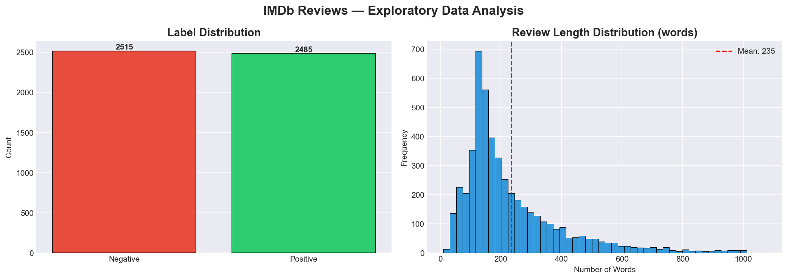
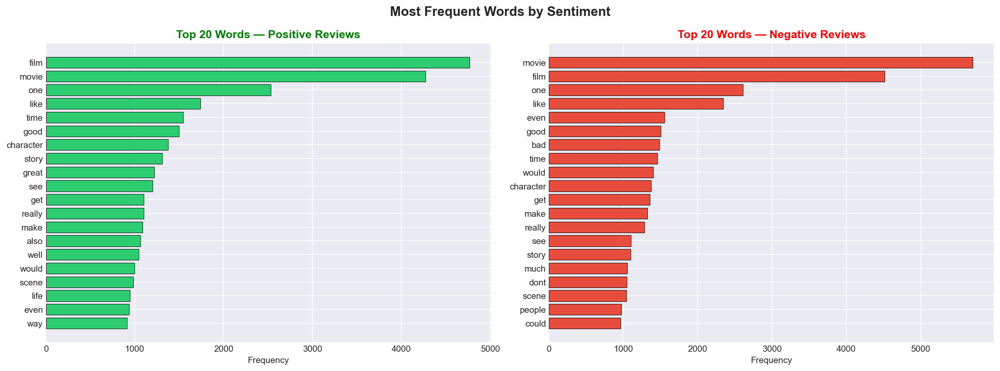
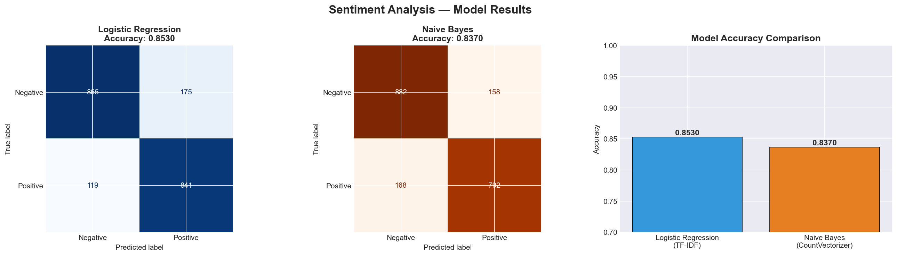
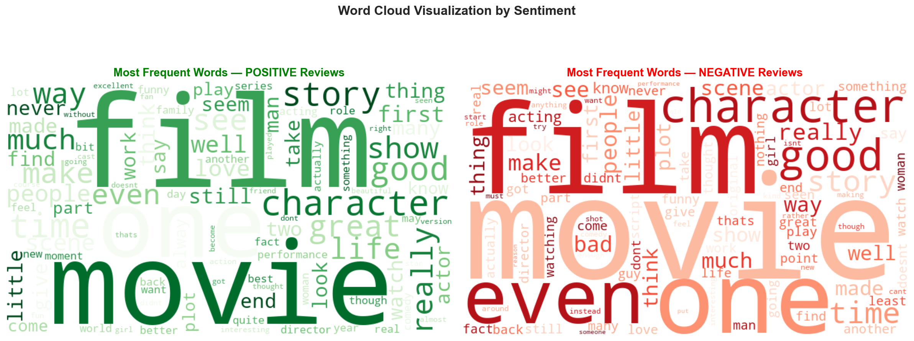

# Task 1: Sentiment Analysis on Product Reviews

## Overview
This project classifies **IMDb movie reviews** as **positive** or **negative** using classical NLP techniques. The pipeline evaluates Logistic Regression and Naive Bayes models on features extracted via TF-IDF and CountVectorizer.

## Project Structure
```text
Task_1_Sentiment_Analysis/
├── assets/                  # Output images (word clouds, model comparison, top words)
│   ├── eda_plots.png
│   ├── model_comparison.png
│   ├── top_words.png
│   └── wordclouds.png
├── data/                    # Dataset files and generated results
│   ├── train.csv            # IMDb training split (local cache)
│   ├── test.csv             # IMDb test split (local cache)
│   ├── results.csv          # Per-sample model predictions
│   └── results_summary.json # Aggregated accuracy/F1 metrics
├── models/                  # Saved trained models (Joblib)
├── notebooks/               # Jupyter notebook for EDA
│   └── sentiment_analysis.ipynb
├── src/                     # Source code
│   ├── main.py              # Pipeline runner (train + evaluate)
│   ├── preprocess.py        # Text cleaning and lemmatization
│   ├── train.py             # Model training and evaluation logic
│   └── generate_results.py  # Standardized results reporter (CSV + JSON)
├── tests/                   # Unit tests
│   └── test_preprocess.py
├── README.md                # Project documentation
└── requirements.txt         # Python dependencies
```

## Installation
```bash
pip install -r requirements.txt
```

## Usage

Run the main training & evaluation pipeline:
```bash
python src/main.py
```

Generate standardized results (CSV + JSON export):
```bash
python src/generate_results.py
```

Run unit tests:
```bash
python -m pytest tests/ -v
```

## Results

| Model | Accuracy | Precision | Recall | F1-Score |
|-------|----------|-----------|--------|----------|
| **Logistic Regression (TF-IDF)** | **85.3%** | 82.8% | 87.6% | **85.1%** |
| Naive Bayes (CountVec) | 83.7% | 83.4% | 82.5% | 82.9% |

> Test set: **2,000 samples** evaluated. Best model: **Logistic Regression**.

## Findings
- **Logistic Regression** with **TF-IDF (1-2 ngrams)** outperforms Naive Bayes by ~1.6% accuracy.
- TF-IDF captures contextual word importance more effectively than raw word counts (BoW).
- Word clouds reveal clear lexical signals: positive reviews use words like *"great", "love", "beautiful"*; negative reviews use *"worst", "boring", "waste"*.

## Visualizations

**EDA — Dataset Distribution**


**Top Discriminating Words**


**Model Accuracy Comparison**


**Positive vs. Negative Word Clouds**

