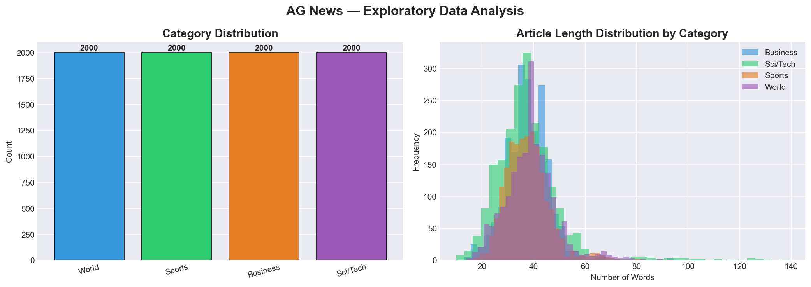
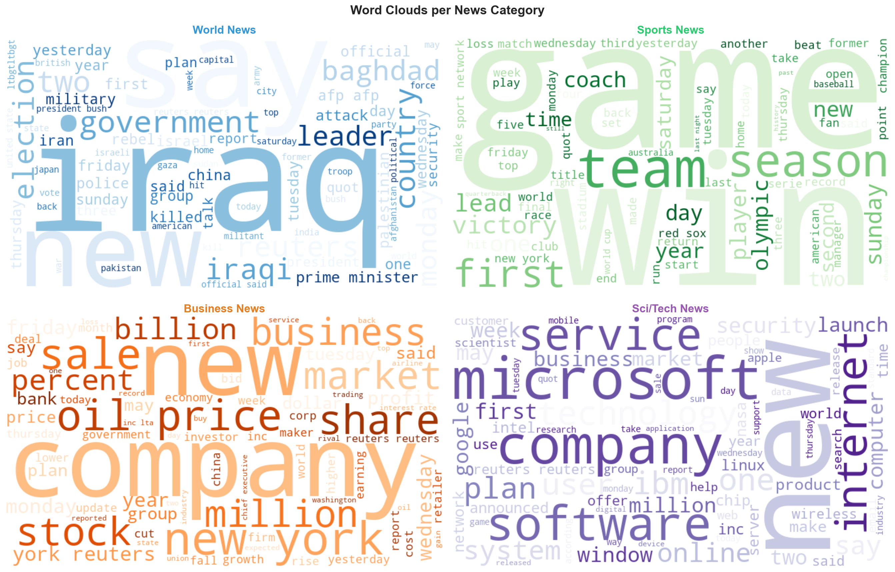
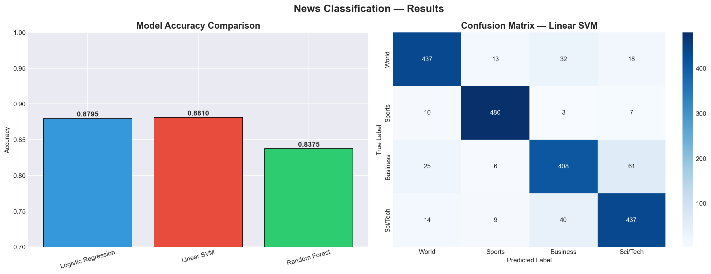

# Task 2: News Category Classification

## Overview
This project classifies **news articles** into four categories — **World, Sports, Business, and Science/Technology** — using multiclass text classification models on the **AG News** benchmark dataset.

## Project Structure
```text
Task_2_News_Classification/
├── assets/                       # Output images (word clouds, classification results, EDA)
│   ├── category_wordclouds.png
│   ├── classification_results.png
│   └── eda_plots.png
├── data/                         # Dataset files and generated results
│   ├── train.csv                 # AG News training split (local cache)
│   ├── test.csv                  # AG News test split (local cache)
│   ├── results.csv               # Per-sample model predictions
│   └── results_summary.json      # Aggregated accuracy/F1 metrics
├── models/                       # Saved trained models (Joblib)
├── notebooks/                    # Jupyter notebook for EDA
├── src/                          # Source code
│   ├── main.py                   # Pipeline runner (train + evaluate)
│   ├── preprocess.py             # Text cleaning and lemmatization
│   ├── train.py                  # Model training and evaluation logic
│   └── generate_results.py       # Standardized results reporter (CSV + JSON)
├── tests/                        # Unit tests
│   └── test_preprocess.py
├── README.md                     # Project documentation
└── requirements.txt              # Python dependencies
```

## Installation
```bash
pip install -r requirements.txt
```

## Usage

Run the main training & evaluation pipeline:
```bash
python src/main.py
```

Generate standardized results (CSV + JSON export):
```bash
python src/generate_results.py
```

Run unit tests:
```bash
python -m pytest tests/ -v
```

## Results

| Model | Accuracy | Macro Precision | Macro Recall | Macro F1 |
|-------|----------|-----------------|--------------|----------|
| Logistic Regression | 87.95% | 87.92% | 87.95% | 87.92% |
| **Linear SVM** | **88.1%** | **88.11%** | **88.1%** | **88.08%** |
| Random Forest | 83.75% | 83.72% | 83.75% | 83.68% |

> Test set: **2,000 samples** evaluated (500 per class). Best model: **Linear SVM**.

## Findings
- **Linear SVM** achieves the best performance at **88.1% accuracy**, outperforming Logistic Regression and Random Forest.
- TF-IDF effectively captures discriminative features for 4-class categorization with minimal preprocessing.
- Random Forest underperforms due to fewer ensemble trees and sparse high-dimensional TF-IDF features.
- The AG News categories are well-separated, making classification relatively manageable.

## Visualizations

**EDA — Category Distribution**


**Category Word Clouds**


**Classification Results Comparison**

