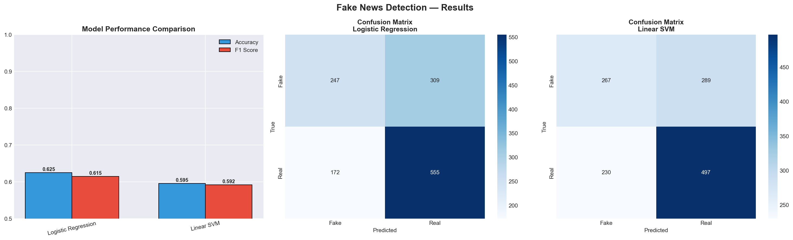
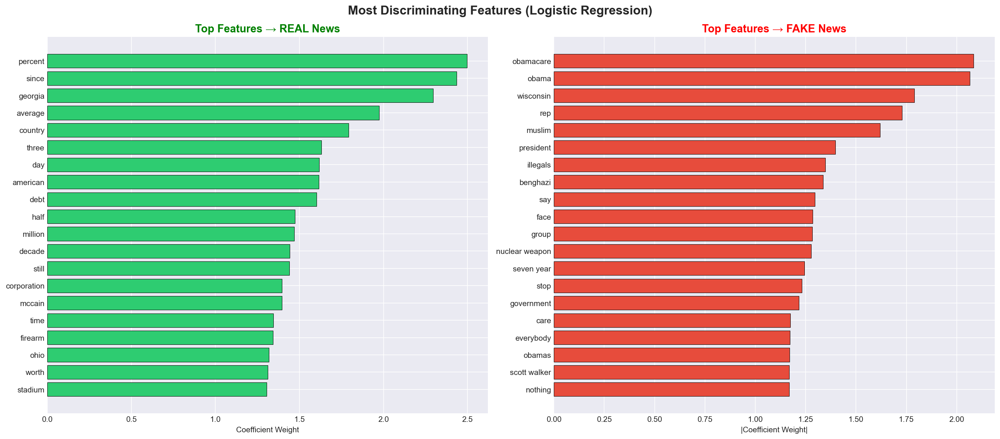
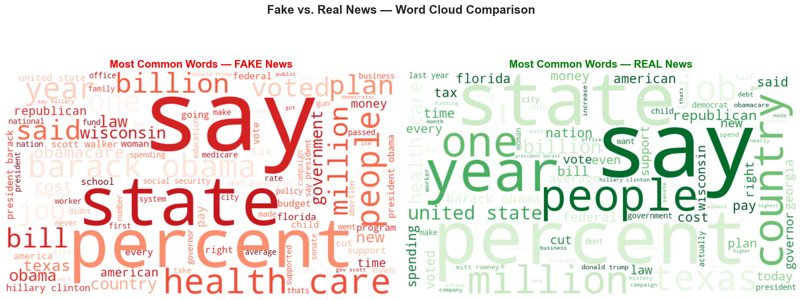
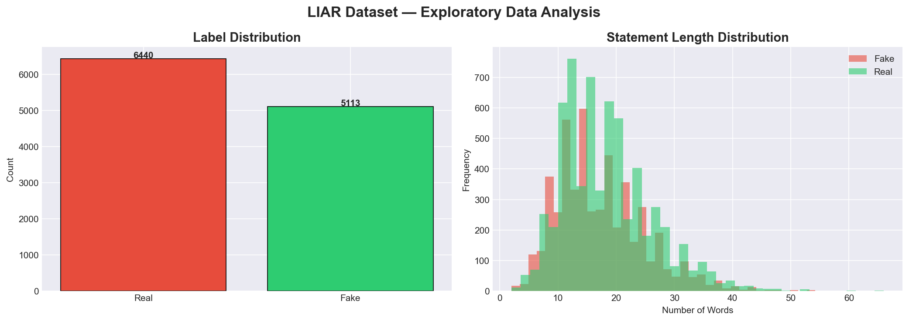

# Task 3: Fake News Detection

## Overview
This project classifies political news statements as **real** or **fake** using binary text classification models trained on the benchmark **LIAR dataset** from PolitiFact. N-gram feature engineering (up to trigrams) is used to capture subtle language patterns in political speech.

## Project Structure
```text
Task_3_Fake_News/
├── assets/                        # Output images (word clouds, feature charts, EDA)
│   ├── detection_results.png
│   ├── discriminating_features.png
│   ├── eda_plots.png
│   └── fake_vs_real_wordclouds.png
├── data/                          # Dataset files and generated results
│   ├── train.csv                  # LIAR training split (local cache)
│   ├── test.csv                   # LIAR test split (local cache)
│   ├── results.csv                # Per-sample model predictions
│   └── results_summary.json       # Aggregated accuracy/F1 metrics
├── models/                        # Saved trained models (Joblib)
├── notebooks/                     # Jupyter notebook for EDA
├── src/                           # Source code
│   ├── main.py                    # Pipeline runner (train + evaluate)
│   ├── preprocess.py              # Text cleaning and binary label mapping
│   ├── train.py                   # Model training and evaluation logic
│   └── generate_results.py        # Standardized results reporter (CSV + JSON)
├── tests/                         # Unit tests
│   └── test_preprocess.py
├── README.md                      # Project documentation
└── requirements.txt               # Python dependencies
```

## Installation
```bash
pip install -r requirements.txt
```

## Usage

Run the main training & evaluation pipeline:
```bash
python src/main.py
```

Generate standardized results (CSV + JSON export):
```bash
python src/generate_results.py
```

Run unit tests:
```bash
python -m pytest tests/ -v
```

## Results

| Model | Accuracy | Precision (Fake) | Recall (Fake) | F1 Weighted | F1 Macro |
|-------|----------|------------------|---------------|-------------|----------|
| **Logistic Regression** | **62.5%** | 58.95% | 44.42% | 61.5% | **60.2%** |
| Linear SVM | 59.55% | 53.72% | 48.02% | 59.2% | 58.2% |

> Test set: **1,283 samples** evaluated. Best model: **Logistic Regression** (F1 Macro).

## Findings
- **Logistic Regression** with TF-IDF trigrams achieves the best overall performance at **62.5% accuracy** and **60.2% Macro F1**.
- Fake news detection on short political statements is inherently difficult — the LIAR dataset is a known hard benchmark (~62-65% is considered a strong baseline).
- Trigrams (1-3 ngrams) capture important political phrasing nuances that unigrams miss.
- The model is better at detecting **Real** news (recall: 76.3%) than **Fake** news (recall: 44.4%), reflecting class imbalance challenges.

## Visualizations

**Model Performance Results**


**Discriminating Features Analysis**


**Fake vs. Real News Word Clouds**


**EDA — Dataset Distribution**

