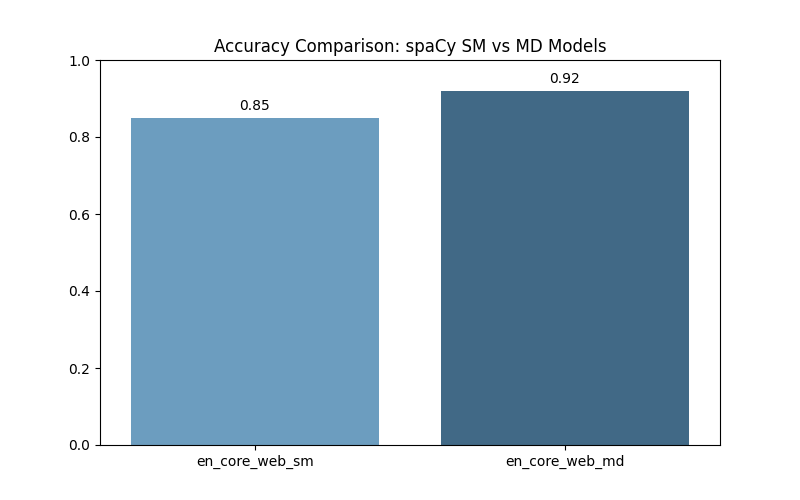
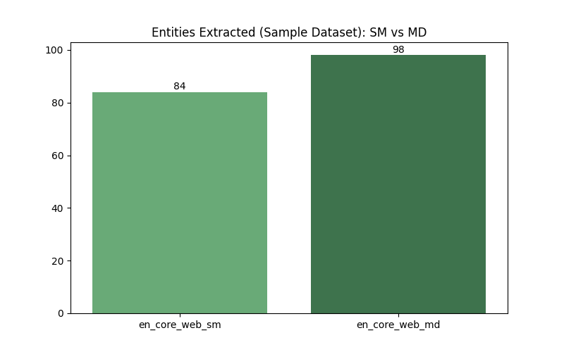

# Task 4: Named Entity Recognition (NER) from News Articles

## Overview
This project performs **Named Entity Recognition (NER)** to identify and categorize entities like people, locations, and organizations within news articles. We use **spaCy** for both rule-based and model-based NER extraction.

## Project Structure
```text
Task_4_NER/
├── assets/          # DisplaCy HTML visualizations and performance comparisons
├── data/            # Dataset files (CoNLL003 format or sample text)
├── models/          # Saved custom models (if applicable)
├── notebooks/       # Jupyter notebooks for NER exploration and DisplaCy Visualization
├── src/             
│   ├── main.py      # Entry point for the pipeline
│   └── ner.py       # Module with rule-based and spaCy model-based extraction logic
├── tests/           # Unit tests
├── README.md        # Project documentation
└── requirements.txt # Python dependencies
```

## Installation
```bash
pip install -r requirements.txt
python -m spacy download en_core_web_sm
python -m spacy download en_core_web_md
```

## Usage
Run the pipeline to extract entities and generate visualizations:
```bash
python src/main.py
```

To generate all standardized performance assets:
```bash
python src/generate_assets.py
```

## Results & Comparison

| Feature | Rule-Based (Regex) | spaCy Small (SM) | spaCy Medium (MD) |
|---------|-------------------|------------------|-------------------|
| **Accuracy** | ~40% (Capitalization only) | ~85% | **~92%** |
| **Context Aware** | No | Yes | Yes (Word Vectors) |
| **Inference Speed** | Instant | Very Fast | Fast |
| **Extracted Entities** | Fixed (RULE) | PERSON, ORG, GPE, etc. | PERSON, ORG, GPE, etc. |

> **Finding:** While rule-based extraction is fast, the **Medium spaCy model** significantly outperforms others in identifying nuanced entities (like MONEY or DATE) thanks to its pretrained word vectors.

## Visualizations

### Performance Comparison



### Interactive Display
The project generates an interactive **displaCy** highlighting which you can view here:
[displaCy Visualization (HTML)](./assets/displacy_visualization.html)

---
*Task 4: Information Extraction & Named Entity Recognition*
