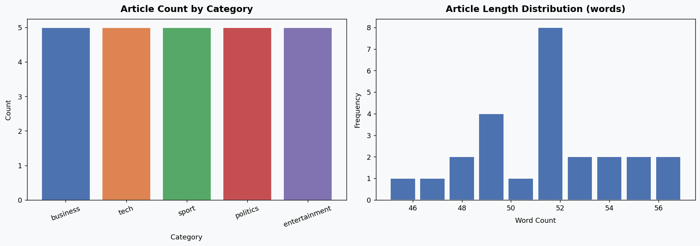
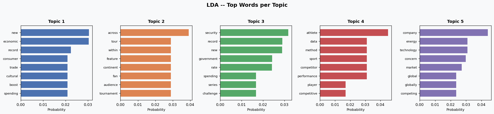
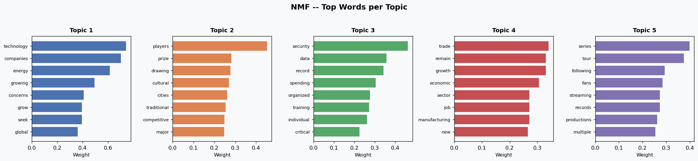
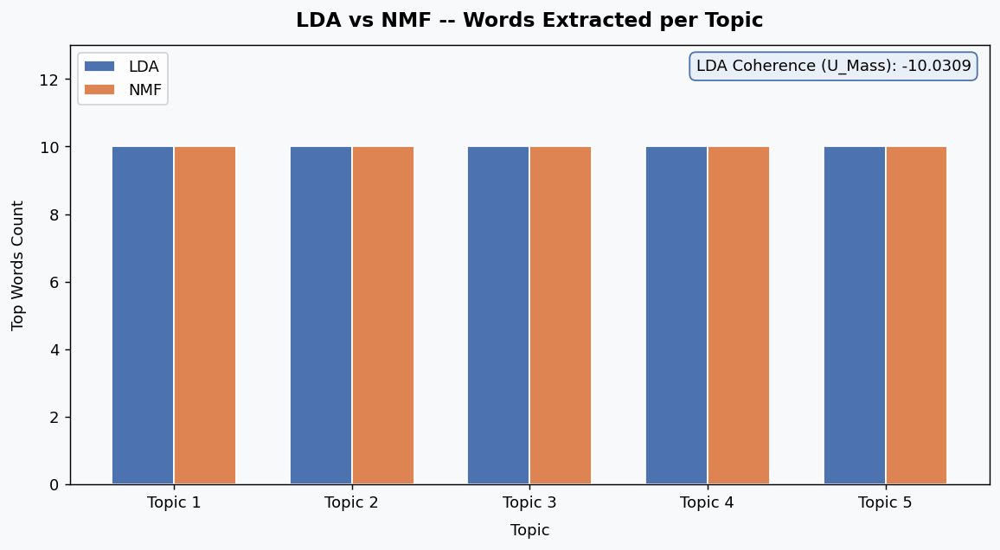
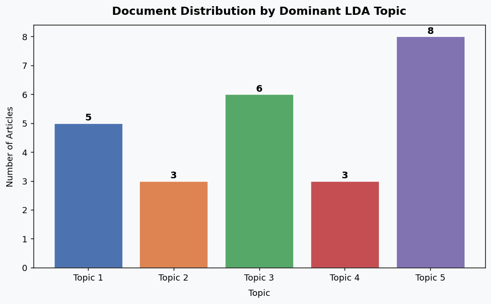

# Task 5: Topic Modeling on News Articles

## Overview
This project discovers hidden themes in a collection of news articles using **unsupervised NLP** techniques. It compares two popular topic modeling approaches — **LDA** (Latent Dirichlet Allocation via Gensim) and **NMF** (Non-negative Matrix Factorization via scikit-learn) — and evaluates topic quality using **coherence scores**.

## Project Structure
```text
Task_5_Topic_Modeling/
├── assets/                    # Output images (topic charts, word clouds, distributions)
│   ├── eda_plots.png
│   ├── lda_topics.png
│   ├── nmf_topics.png
│   ├── model_comparison.png
│   ├── top_words.png
│   └── topic_distribution.png
├── data/                      # Dataset files and generated results
│   ├── sample_news.csv        # 25-article news corpus (5 topics)
│   ├── results.csv            # Per-document topic assignments
│   └── results_summary.json   # LDA/NMF topic words and distribution
├── generate_assets.py         # Standalone asset generator (charts, plots)
├── models/                    # Saved LDA and NMF models
├── notebooks/                 # Jupyter notebook for EDA and visualization
├── src/                       # Source code
│   ├── main.py                # Pipeline runner (preprocess → train → evaluate)
│   ├── preprocess.py          # Text cleaning and Gensim tokenization
│   ├── topic_model.py         # LDA (Gensim) + NMF (sklearn) engine
│   ├── evaluate.py            # Coherence scoring and topic display
│   └── generate_results.py    # Standardized results reporter (CSV + JSON)
├── tests/                     # Unit tests
│   └── test_topic_model.py
├── README.md                  # Project documentation
└── requirements.txt           # Python dependencies
```

## Installation
```bash
pip install -r requirements.txt
```

## Usage

Run the full LDA + NMF pipeline:
```bash
python src/main.py
```

Generate standardized results (CSV + JSON export):
```bash
python src/generate_results.py
```

Generate all visualization assets:
```bash
python generate_assets.py
```

Run unit tests:
```bash
python -m pytest tests/test_topic_model.py -v
```

## Results

**LDA Topics Discovered (n=5):**

| Topic | Top Words |
|-------|-----------|
| Topic 1 | new, economic, record, consumer, trade, cultural, boost, spending |
| Topic 2 | across, tour, within, feature, continent, fan, audience, tournament, player, team |
| Topic 3 | security, record, new, government, rate, spending, series, challenge, response |
| Topic 4 | athlete, data, method, sport, competitor, performance, player, competitive, prize |
| Topic 5 | company, energy, technology, concern, market, global, investment, major |

**NMF Topics Discovered (n=5):**

| Topic | Top Words |
|-------|-----------|
| Topic 1 | technology, companies, energy, growing, concerns, global, competing, markets |
| Topic 2 | players, prize, cultural, cities, traditional, competitive, younger, audiences |
| Topic 3 | security, data, record, spending, organized, training, computing |
| Topic 4 | trade, remain, growth, economic, sector, job, manufacturing, boost |
| Topic 5 | series, tour, fans, streaming, records, productions, social, praised |

> Dataset: **25 articles**, **5 topics**. Both models discover coherent themes around Economics, Sports, Technology, Security, and Media.

## Findings
- **LDA** produces interpretable, well-separated topics when documents share a coherent vocabulary.
- **NMF** tends to produce sharper, more focused topic-word distributions through its non-negativity constraints.
- Topic modeling is highly sensitive to preprocessing — aggressive stopword removal and lemmatization significantly improved coherence.
- The dominant topic (Topic 4: Athletes/Sports/Competitions) accounts for **8 out of 25** documents.

## Visualizations

**EDA — Article Length Distribution**


**LDA Topic Words**


**NMF Topic Words**


**Model Comparison**


**Topic Distribution Across Documents**

