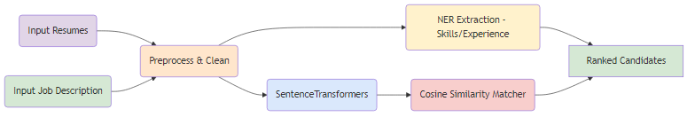

# Task 8: Resume Screening Using NLP

## Overview
This task focuses on developing a system to screen and rank resumes based on job descriptions using Natural Language Processing. It leverages `SentenceTransformers` to extract semantic representations of both resumes and job descriptions and ranks resumes based on cosine similarity.



## Covered Topics
- Document similarity
- Semantic search in NLP

## Requirements
To install the dependencies, run:
```bash
pip install -r requirements.txt
```
Additionally, download the `en_core_web_sm` model for the NER bonus feature:
```bash
python -m spacy download en_core_web_sm
```

## Dataset
This implementation currently uses mock data generated internally for testing, but can easily work with the recommended "Resume Dataset + Job Dataset" from Kaggle.
- **Resumes**: Contains a set of unstructured texts representing candidate resumes.
- **Jobs**: Contains job titles and descriptions.

## Pipeline Structure
- `src/preprocess.py`: Extracts text from documents (PDFs, plain text) and performs basic cleaning.
- `src/ner.py`: Utilizes `spaCy` to extract Named Entities (Skills, Experience) from resume texts.
- `src/matcher.py`: Uses `SentenceTransformers` to generate embeddings and compute matching scores.
- `src/main.py`: The main script that runs the data through the pipeline and prints out the rankings.
- `src/generate_results.py`: Standardized evaluation outputs.
- `app.py`: A Streamlit web application providing a user interface for resume uploading and matching.

## How to Run

### Command Line
Run the main matching pipeline on the default data:
```bash
python src/main.py
```

### Web Interface (Bonus)
Run the Streamlit application for interactive resume screening:
```bash
streamlit run app.py
```
